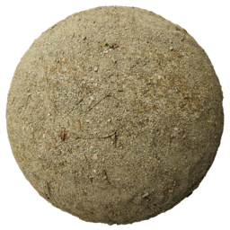
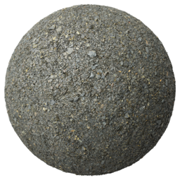
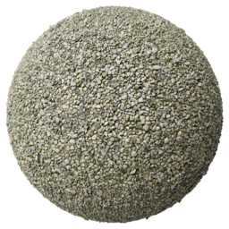
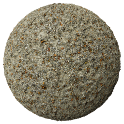
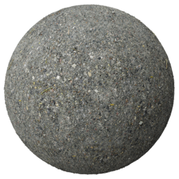

# ambientCG: Gravel materials

**5 assets from [ambientCG](https://ambientcg.com), dedicated to the public domain under [CC0](https://docs.ambientcg.com/license/).** Use them in any game, free or paid, and change them however you like; no credit is needed.

PBR materials as 1K and 2K JPG maps (colour, normal GL and DX, roughness, AO, displacement), one folder per resolution. 218.9 MB in all.

This is a copy kept by [zuujis-cc0](https://github.com/zuujis-cc0) so game makers can take single files from GitHub. It is not made by or affiliated with ambientCG: the originals, often in more formats and higher resolutions, are on [ambientcg.com](https://ambientcg.com). If they help you, consider [supporting ambientCG](https://www.patreon.com/ambientCG).

Every file is listed in [MANIFEST.tsv](MANIFEST.tsv) with its size and SHA-256. More free assets: [the Zuujis collection](https://github.com/zuujis-cc0/free-game-assets#readme).

| | | | |
| :-: | :-: | :-: | :-: |
|  <b><a href="Gravel039">Gravel 039</a></b> by ambientCG · <a href="https://ambientcg.com/a/Gravel039">source</a> |  <b><a href="Gravel040">Gravel 040</a></b> by ambientCG · <a href="https://ambientcg.com/a/Gravel040">source</a> |  <b><a href="Gravel041">Gravel 041</a></b> by ambientCG · <a href="https://ambientcg.com/a/Gravel041">source</a> |  <b><a href="Gravel042">Gravel 042</a></b> by ambientCG · <a href="https://ambientcg.com/a/Gravel042">source</a> |
|  <b><a href="Gravel043">Gravel 043</a></b> by ambientCG · <a href="https://ambientcg.com/a/Gravel043">source</a> |  |  |  |

---

Kept up to date by this repository's own [update workflow](.github/workflows/update.yml), with code and plan from [cc0-mirror](https://github.com/zuujis-cc0/cc0-mirror). Something wrong? [Open an issue there](https://github.com/zuujis-cc0/cc0-mirror/issues/new) or use the [private report form](https://games.zuujis.com/report).
